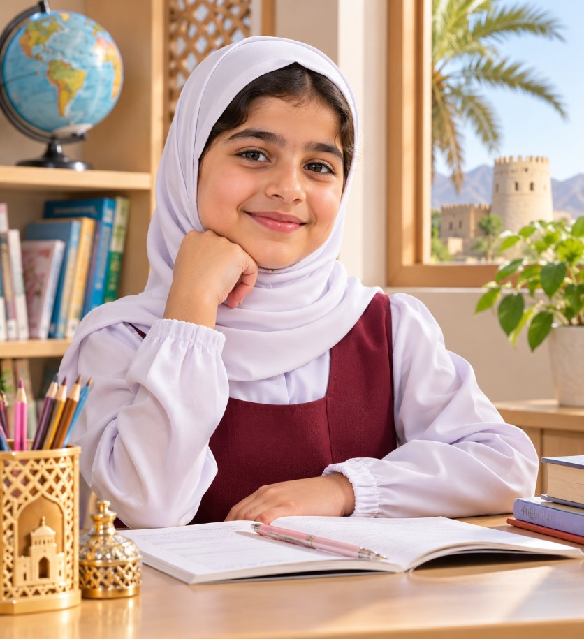
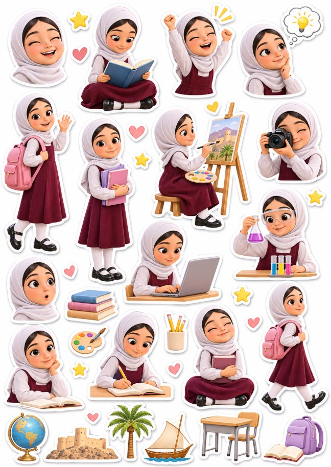
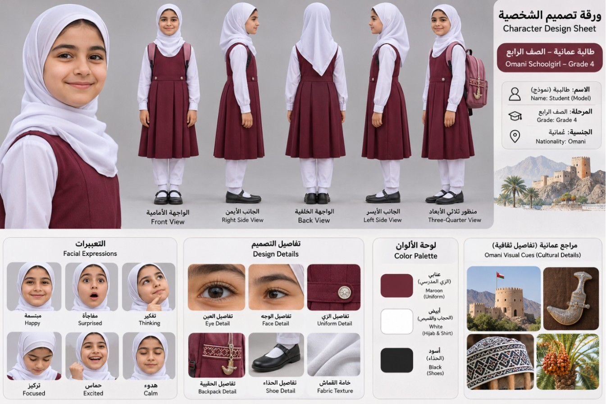

# omani-student-visuals

مهارة (Skill) لتوليد حزمة صور متكاملة لطلاب المدارس العُمانية من وصف أو صورة: صور رئيسية وزوايا تصوير، أوراق شخصية ووجه وعين، لوحات قصصية، صور سينمائية، نماذج كوب وتيشيرت، وورقتا ملصقات A4 — مع الالتزام بالزي المدرسي العُماني.

An agent skill that produces a full visual studio package for Omani school students (hero shots, camera-angle sets, character sheets, storyboards, mockups and A4 sticker sheets) following Omani school uniform rules.

## أمثلة من المخرجات | Examples

مخرجات فعلية من تجربة المهارة بطلب: «طالبة عُمانية، الصف الرابع» — صورة رئيسية، ورقة الشخصية، وورقة ملصقات A4.

Real outputs from testing the skill with "Omani girl, grade 4".

| Hero image | Sticker sheet (A4) |
|---|---|
|  |  |

**Character design sheet**

## Structure
- `SKILL.md` — main instructions
- `agents/openai.yaml` — display metadata
- `assets/icon.svg`

## Install
Copy the `omani-student-visuals` folder into your skills directory (e.g. `~/.claude/skills/`), or download the repo as ZIP and upload it as a skill.

By [AIOMAN](https://github.com/AIOMAN-OM)
