# omani-student-visuals

مهارة (Skill) لتوليد حزمة من 24 صورة بوضعيات وزوايا وأساليب مختلفة لطلاب المدارس العُمانية من وصف أو صورة: صور رئيسية وزوايا تصوير، أوراق شخصية ووجه وعين، لوحات قصصية، صور سينمائية، نماذج كوب وتيشيرت، وورقتا ملصقات A4 — مع الالتزام بالزي المدرسي العُماني.

An agent skill that produces a full 24-image visual studio package for Omani school students (hero shots, camera-angle sets, character sheets, storyboards, mockups and A4 sticker sheets) following Omani school uniform rules.

## أمثلة من المخرجات | Examples

الحزمة الكاملة (24 صورة) من تجربة فعلية للمهارة في ChatGPT بطلب: «طالبة عُمانية، الصف الرابع» — وُلّدت على 4 دفعات، كل صورة مستقلة بوضعية وزاوية مختلفة، بدون أعلام أو شعارات أو نصوص.

The full 24-image default package from a real run of the skill ("Omani girl, grade 4"), generated in 4 batches — every image is a separate new generation with its own pose and camera angle.

| | | | |
|---|---|---|---|
| 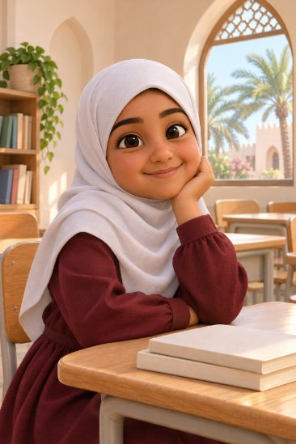 01. Hero | 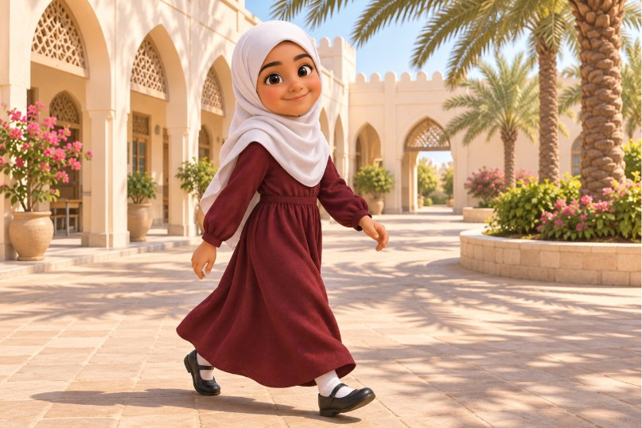 02. Wide – courtyard walk | 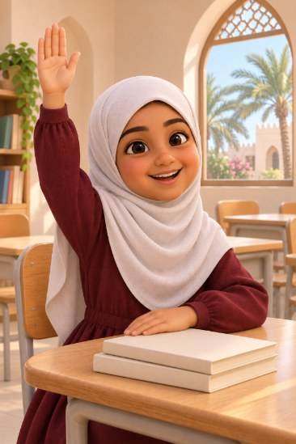 03. Medium – raising hand | 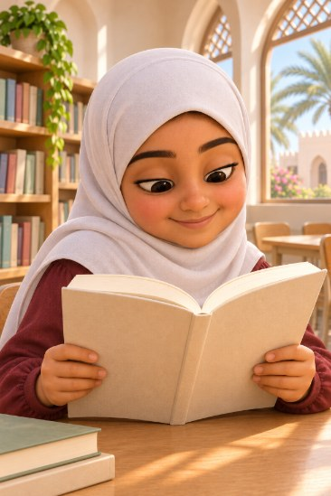 04. Close-up – reading |
| 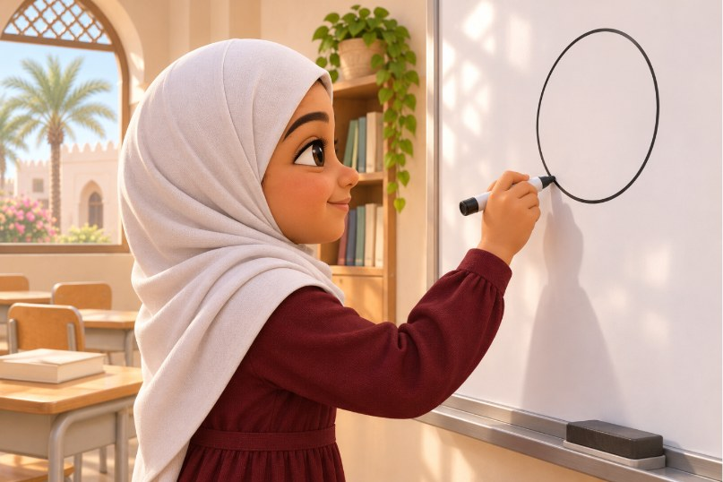 05. Profile – whiteboard | 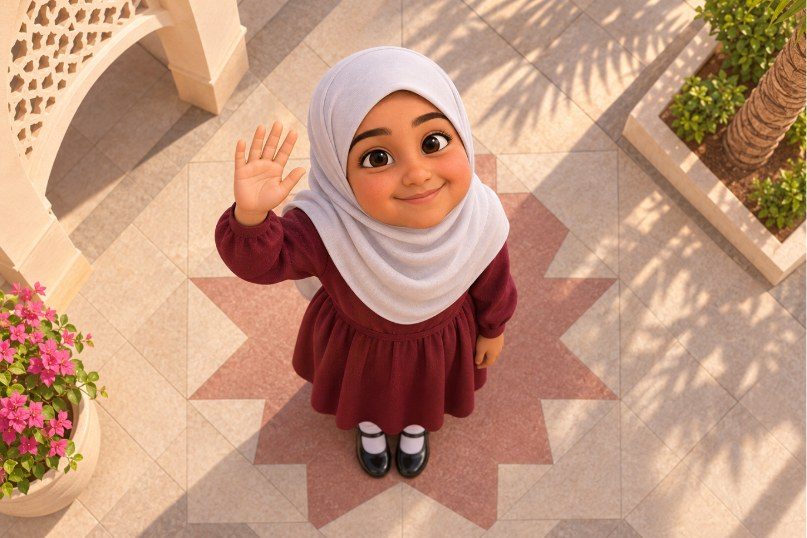 06. Drone top-down | 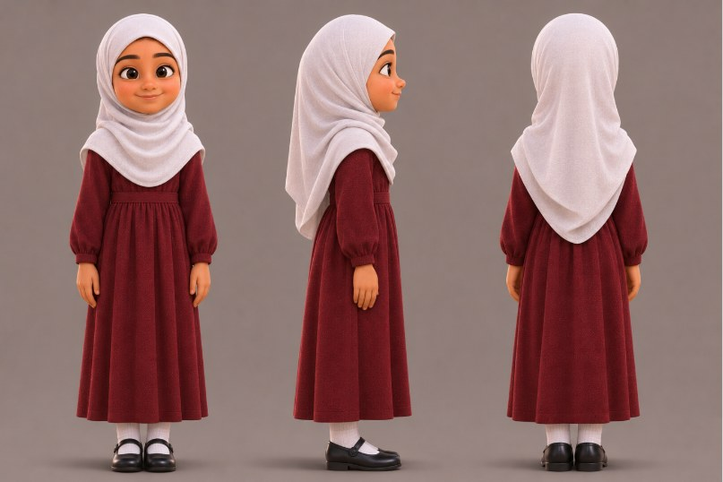 07. Turnaround sheet | 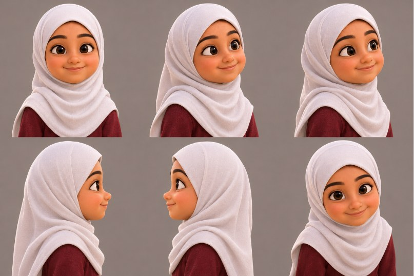 08. Face-angle sheet |
| 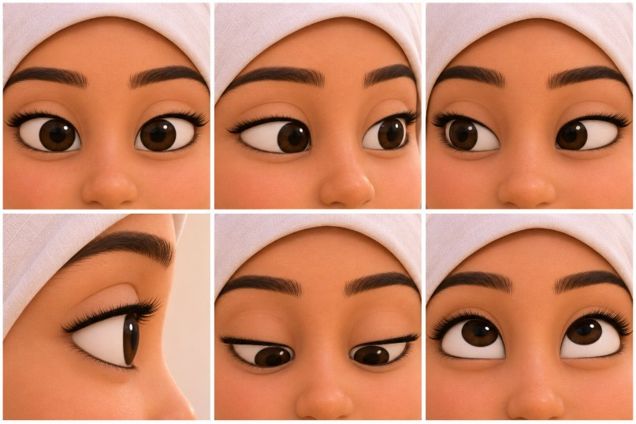 09. Eye-angle sheet | 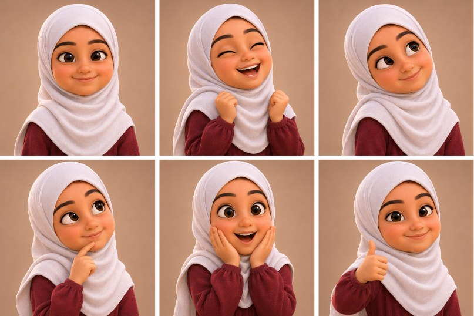 10. Portrait expressions | 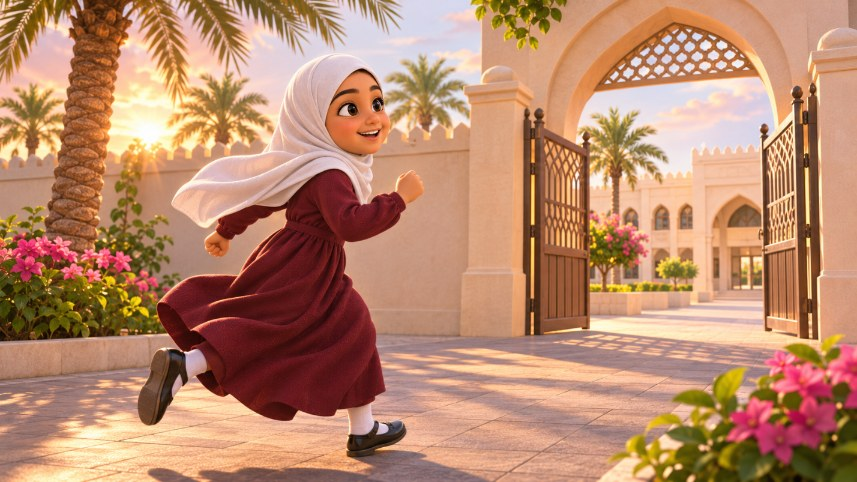 11. Cinematic – golden hour | 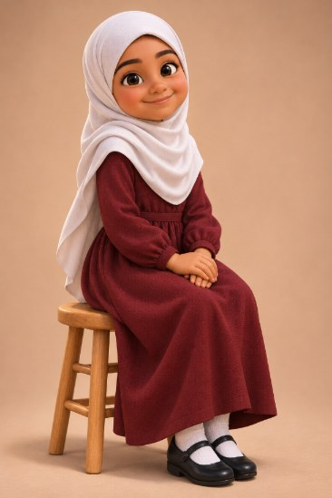 12. Editorial – studio |
| 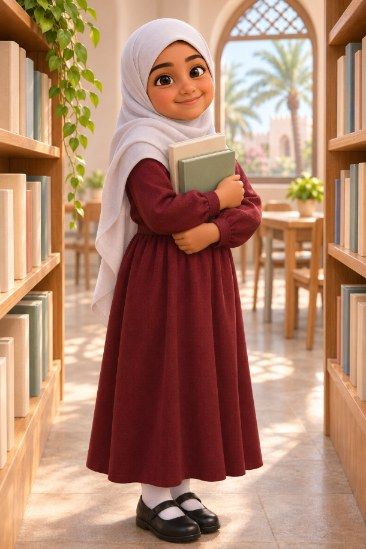 13. Canon 50mm – library | 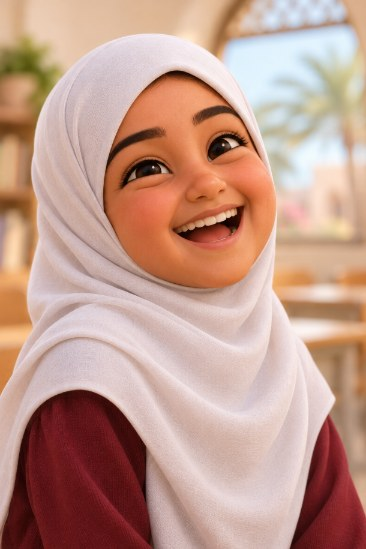 14. Canon 85mm – laughing | 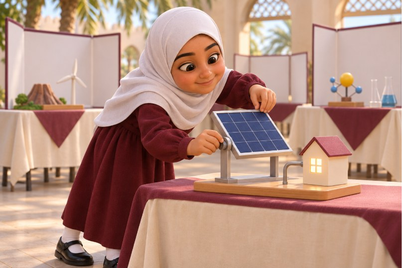 15. Canon 70–200mm – science fair | 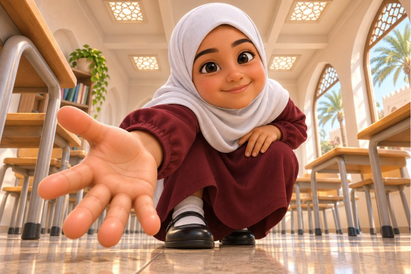 16. Ground-level ultra-wide |
| 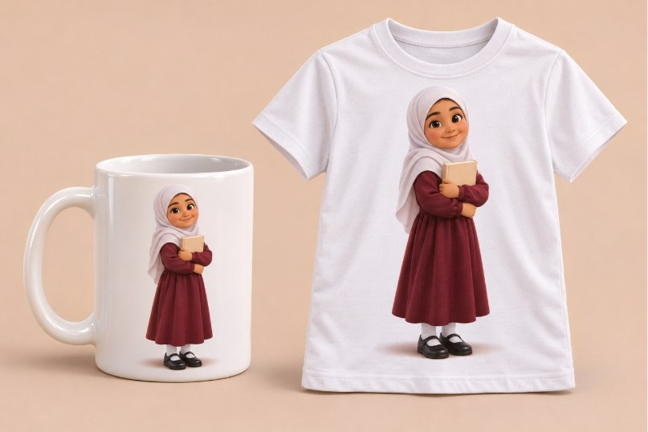 17. Mug & T-shirt mockup | 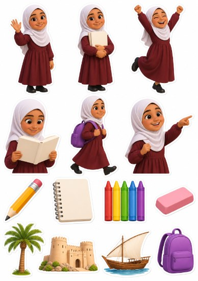 18. Assorted A4 stickers | 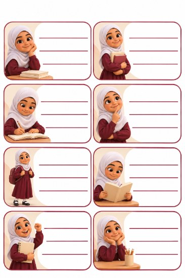 19. School-label A4 sheet | 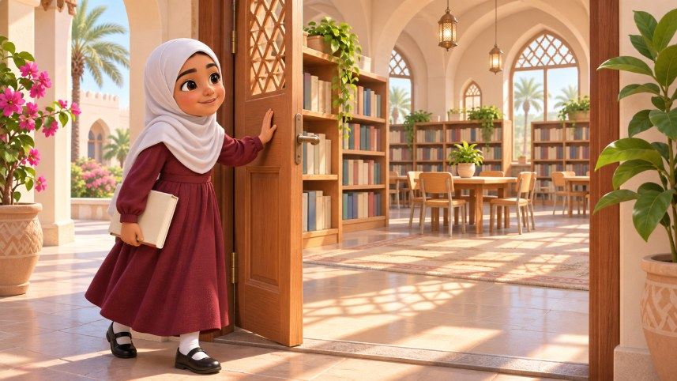 20. Storyboard – opening |
| 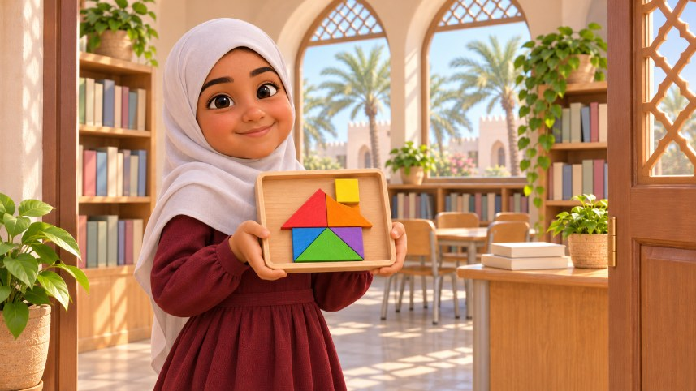 21. Storyboard – closing | 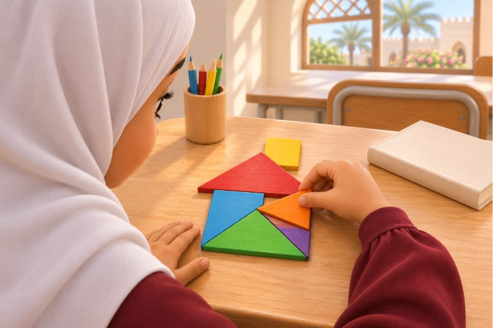 22. Over-the-shoulder – puzzle | 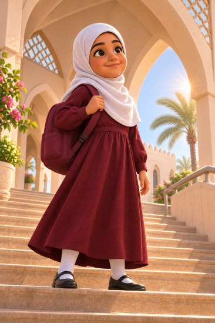 23. Low-angle – stairs | 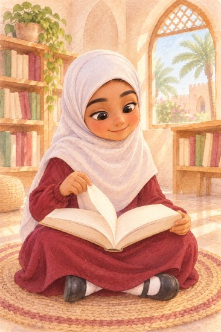 24. Watercolor – library |

## Structure
- `SKILL.md` — main instructions
- `agents/openai.yaml` — display metadata
- `assets/icon.svg`

## Install
Copy the `omani-student-visuals` folder into your skills directory (e.g. `~/.claude/skills/`), or download the repo as ZIP and upload it as a skill.

By [AIOMAN](https://github.com/AIOMAN-OM)

## License

MIT — see [LICENSE](LICENSE).
